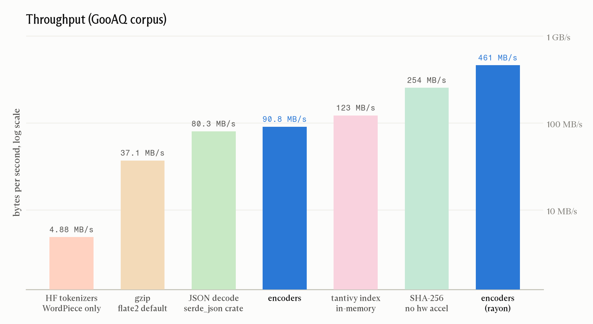
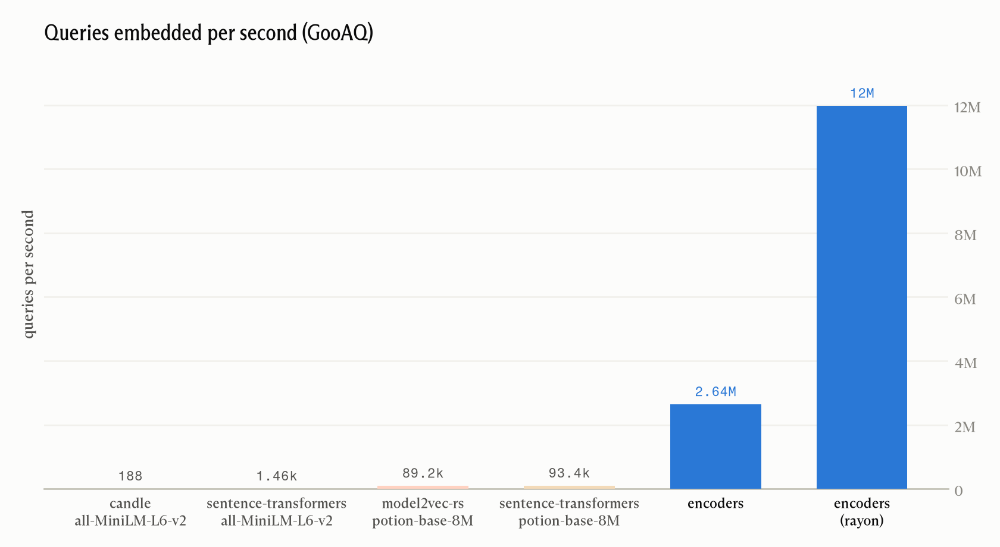

<div align="right">

[


](https://crates.io/crates/encoders)

</div>

# encoders

The encoders crate is the **fastest way to semantically embed text** on CPU.[^1] We take [a collection of state-of-the-art](#configuration-and-model-selection) static embedding models, and compile them directly into Rust code. That means no downloading models at runtime, no GPU, no inference runtime, no Python... just nanosecond scale text embedding.

- [Read our article all about it here!](https://flowercomputer.com/news)
- [encoders on crates.io](https://crates.io/crates/encoders)
- [encoders on docs.rs](https://docs.rs/crate/encoders/latest)

```rust
let query = encoders::encode_single("What is the capital of France?");
let docs = encoders::encode(["Paris is the capital of France.", "Tokyo is the capital of Japan."]);

for (doc, text) in docs.iter().zip(["Paris...", "Tokyo..."]) {
    println!("{:.3}  {text}", encoders::similarity(&query, doc));
}
```

You can also configure encoders with a number of crate features for model selection, quantization, Matryoshka truncation (depending on a model's support for it), and parallelization (via [rayon](https://github.com/rayon-rs/rayon)).

```console
$ cargo add encoders
$ cargo add encoders --features='potion-retrieval-32m, int8, mrl-256, rayon'
```

## Performance

Encoders is fast. To give you an idea of just _how_ fast, here's encoders compared to a handful of other throughput-sensitive tasks (measured on an Apple M3 Pro CPU):



## Configuration and model selection

> [!WARNING]
> If you store embeddings from this crate, you should explicitly [select a model feature](https://github.com/flowercomputers/encoders/blob/791c5caaf24e590e2095ace17df137dc652d2739/Cargo.toml#L33-L52)!
> _**We will change the default model and features between major versions**_ as better models become available!

```toml
[dependencies]
encoders = { version = "2", features = ["bekko-static-v1-slim-32k", "mrl-256", "int8", "rayon"] }
```

### Features:

- **Model.** With none enabled you get the current default, `bekko-static-v1-slim-100k` truncated to 512 dimensions. Naming a model explicitly gets its native width.
- **Dimensions.** `mrl-1024` down to `mrl-32` truncates a Matryoshka-trained model to one of the widths it was trained at. Omit it for the model's native width; asking for a width a model was not trained at fails the build!
- **Internal Type.** `int16` is the default, as 16-bit quantization produces almost indistinguishable outputs from f32 in practice (at half the size). `int8` is a quarter the size, with cosine agreement against f32 above 0.999 on multi-token text (so also pretty much indistinguishable).
- **`rayon`** makes `encode` parallel for large batches. This is only likely to improve performance if your workload is routinely encoding very large batches (a couple hundred or more inputs).

#### bekko models

[](https://huggingface.co/flower-computer/bekko-static-v1-slim-50k)

The model [hotchpotch/bekko-static-embedding-v1](https://huggingface.co/hotchpotch/bekko-static-embedding-v1) represents the current state-of-the-art as far as static embedding. We've trained a family of models derived from this model to shrink the vocabulary (and thus the model size), specifically for use in encoders. These are multilingual models, trained with MRL so their vectors can be truncated (reducing vector and model size at the cost of embedding quality), and licensed MIT. [Read all about it on HuggingFace](https://huggingface.co/flower-computer/bekko-static-v1-slim-100k).

<table>
  <thead>
    <tr>
      <th>feature</th>
      <th align="right">vocab</th>
      <th align="right">languages</th>
      <th align="right">NanoBEIR-en</th>
      <th align="right">MNanoBEIR</th>
      <th align="right">size int8 / int16 / f32</th>
    </tr>
  </thead>
  <tbody>
    <tr>
      <td><a href="https://huggingface.co/hotchpotch/bekko-static-embedding-v1"><code>bekko-static-embedding-v1</code></a></td>
      <td align="right">200k</td>
      <td align="right">40</td>
      <td align="right">53.7</td>
      <td align="right">43.7</td>
      <td align="right">258 / 514 / 1026 MiB</td>
    </tr>
    <tr>
      <td><a href="https://huggingface.co/flower-computer/bekko-static-v1-slim-100k"><b><code>bekko-static-v1-slim-100k</code></b></a> (default, at <code>mrl-512</code>)</td>
      <td align="right">100k</td>
      <td align="right">25</td>
      <td align="right">52.9</td>
      <td align="right">43.0</td>
      <td align="right">129 / 257 / 513 MiB</td>
    </tr>
    <tr>
      <td><a href="https://huggingface.co/flower-computer/bekko-static-v1-slim-75k"><code>bekko-static-v1-slim-75k</code></a></td>
      <td align="right">75k</td>
      <td align="right">25</td>
      <td align="right">52.1</td>
      <td align="right">42.2</td>
      <td align="right">129 / 257 / 513 MiB</td>
    </tr>
    <tr>
      <td><a href="https://huggingface.co/flower-computer/bekko-static-v1-slim-50k"><code>bekko-static-v1-slim-50k</code></a></td>
      <td align="right">50k</td>
      <td align="right">25</td>
      <td align="right">50.2</td>
      <td align="right">40.4</td>
      <td align="right">65 / 129 / 257 MiB</td>
    </tr>
    <tr>
      <td><a href="https://huggingface.co/flower-computer/bekko-static-v1-slim-32k"><code>bekko-static-v1-slim-32k</code></a></td>
      <td align="right">32k</td>
      <td align="right">14</td>
      <td align="right">49.3</td>
      <td align="right">39.9</td>
      <td align="right">32 / 64 / 128 MiB</td>
    </tr>
  </tbody>
</table>

Our smallest model, `bekko-static-v1-slim-32k`, covers English, Arabic, German, Spanish, French, Italian, Japanese, Korean, Norwegian, Portuguese, Serbian, Swedish, Thai, and Vietnamese. The larger models also support Bengali, Persian, Finnish, Hindi, Indonesian, Dutch, Russian, Swahili, Telugu, Yoruba, and Chinese.

<details>
<summary><b>Potion models</b></summary>

Small, quick models distilled by [MinishLab](https://github.com/MinishLab) with their [model2vec](https://github.com/MinishLab/model2vec) process: English only, licensed MIT.

<table>
  <thead>
    <tr>
      <th>feature</th>
      <th align="right">native width</th>
      <th>notes</th>
      <th align="right">size int8 / int16 / f32</th>
    </tr>
  </thead>
  <tbody>
    <tr>
      <td><a href="https://huggingface.co/minishlab/potion-base-2M"><code>potion-base-2m</code></a></td>
      <td align="right">64</td>
      <td>general purpose</td>
      <td align="right">2.3 / 4.3 / 8.3 MiB</td>
    </tr>
    <tr>
      <td><a href="https://huggingface.co/minishlab/potion-base-4M"><code>potion-base-4m</code></a></td>
      <td align="right">128</td>
      <td>general purpose</td>
      <td align="right">4.3 / 8.3 / 16 MiB</td>
    </tr>
    <tr>
      <td><a href="https://huggingface.co/minishlab/potion-base-8M"><code>potion-base-8m</code></a></td>
      <td align="right">256</td>
      <td>general purpose</td>
      <td align="right">8.3 / 16 / 32 MiB</td>
    </tr>
    <tr>
      <td><a href="https://huggingface.co/minishlab/potion-base-32M"><code>potion-base-32m</code></a></td>
      <td align="right">512</td>
      <td>general purpose, larger vocabulary</td>
      <td align="right">33 / 65 / 129 MiB</td>
    </tr>
    <tr>
      <td><a href="https://huggingface.co/minishlab/potion-retrieval-32M"><code>potion-retrieval-32m</code></a></td>
      <td align="right">512</td>
      <td>tuned for retrieval</td>
      <td align="right">33 / 65 / 129 MiB</td>
    </tr>
    <tr>
      <td><a href="https://huggingface.co/minishlab/potion-science-8M"><code>potion-science-8m</code></a></td>
      <td align="right">256</td>
      <td>scientific text</td>
      <td align="right">8.3 / 16 / 32 MiB</td>
    </tr>
    <tr>
      <td><a href="https://huggingface.co/minishlab/potion-science-32M"><code>potion-science-32m</code></a></td>
      <td align="right">256</td>
      <td>scientific text, larger vocabulary</td>
      <td align="right">33 / 65 / 129 MiB</td>
    </tr>
    <tr>
      <td><a href="https://huggingface.co/minishlab/potion-code-16M"><code>potion-code-16m</code></a></td>
      <td align="right">256</td>
      <td>source code; ships per-token weights, so use <code>int16</code> or <code>float32</code></td>
      <td align="right">17 / 33 / 65 MiB</td>
    </tr>
    <tr>
      <td><a href="https://huggingface.co/minishlab/M2V_base_output"><code>m2v-base-output</code></a></td>
      <td align="right">256</td>
      <td>the original model2vec release, superseded by potion</td>
      <td align="right">8.3 / 16 / 32 MiB</td>
    </tr>
  </tbody>
</table>

</details>

<details>
<summary><b>sentence-transformers static models</b></summary>

Trained by the [sentence-transformers](https://sbert.net) team with Matryoshka loss (see their [write-up](https://huggingface.co/blog/static-embeddings)), licensed Apache-2.0.

<table>
  <thead>
    <tr>
      <th>feature</th>
      <th>notes</th>
      <th align="right">size int8 / int16 / f32</th>
    </tr>
  </thead>
  <tbody>
    <tr>
      <td><a href="https://huggingface.co/sentence-transformers/static-retrieval-mrl-en-v1"><code>static-retrieval-mrl-en-v1</code></a></td>
      <td>English, tuned for retrieval</td>
      <td align="right">32 / 64 / 128 MiB</td>
    </tr>
    <tr>
      <td><a href="https://huggingface.co/sentence-transformers/static-similarity-mrl-multilingual-v1"><code>static-similarity-mrl-multilingual-v1</code></a></td>
      <td>multilingual, tuned for similarity rather than retrieval</td>
      <td align="right">129 / 257 / 513 MiB</td>
    </tr>
  </tbody>
</table>

</details>

<details>
<summary><b>NIFE (Nearly Inference Free Embeddings)</b></summary>

Static models aligned with a transformer teacher, so an index built with the teacher can be queried with the static model. English language only, licensed MIT.

<table>
  <thead>
    <tr>
      <th>feature</th>
      <th align="right">native width</th>
      <th>teacher</th>
      <th align="right">size int8 / int16 / f32</th>
    </tr>
  </thead>
  <tbody>
    <tr>
      <td><a href="https://huggingface.co/stephantulkens/NIFE-mxbai-embed-large-v1"><code>nife-mxbai-embed-large-v1</code></a></td>
      <td align="right">1024</td>
      <td><a href="https://huggingface.co/mixedbread-ai/mxbai-embed-large-v1">mixedbread-ai/mxbai-embed-large-v1</a></td>
      <td align="right">129 / 257 / 513 MiB</td>
    </tr>
    <tr>
      <td><a href="https://huggingface.co/stephantulkens/NIFE-gte-modernbert-base"><code>nife-gte-modernbert-base</code></a></td>
      <td align="right">768</td>
      <td><a href="https://huggingface.co/Alibaba-NLP/gte-modernbert-base">Alibaba-NLP/gte-modernbert-base</a></td>
      <td align="right">97 / 193 / 385 MiB</td>
    </tr>
  </tbody>
</table>

</details>

<details>
<summary><b>Other models</b></summary>

We try to cover the spread as far as static embedding models, but if you have a static embedding model not yet included in this crate, please let us know! We are happy to add support for it.

Otherwise, check out the [`ese-build`](./ese-build) and [`ese`](./ese) crates, which can be used to deploy private and local models.

</details>

## Methodology

The idea behind encoders (and the crate that underpins it, [`ese`](./ese)) is simple: static embedding models are essentially lookup tables from token IDs to weights. Why not just resolve the tokens to their weights with a compile-time map? So, that's exactly what it does—with a lot of other performance-oriented tricks to boot!



<!-- TODO: Some Specifics re: internal quantization method, accumulation, tokenization, unbounded input size etc -->

The workspace has four crates. `encoders` is the one above. [`ese`](./ese) is the runtime: a byte-for-byte reimplementation of the BERT tokenizer pipeline, mean pooling in integer lanes, and a perfect-hash table over the vocabulary. [`ese-build`](./ese-build) runs in [`build.rs`](./build.rs): it fetches a model, works out how it is laid out and how it expects to be pooled from its own files, quantizes it, and writes the tables. [`ese-unicode`](./ese-unicode) is the 64 KB of Unicode tables the tokenizer needs, generated from pinned crates and checked in.

### Caveats emptor

**Embedding quality.** Encoders only works with static embedding models: each token has one fixed vector and a text is the mean of its tokens' vectors. There is no attention, so word order and context are invisible, and quality is a step below even small transformer encoders. On retrieval benchmarks the gap is real but not enormous; the bekko family scores about 49 to 54 on NanoBEIR against the low 60s for a small transformer. In exchange, embedding text runs in the order of nanoseconds instead of milliseconds. For a lot of (if not most) search, dedup, clustering, and routing work, that is the right trade (and we hope the speed makes up for the rest).

**Binary size and compile time.** The model's lookup table is embedded in your executable, so this can add a few MB (for a small model at a narrow width) up to a few hundred MB for a model large vocabulary at full width in f32. That said, any model needs its weights at runtime somehow; this crate just puts them in the binary rather than downloading/loading them at runtime. The first build of a model downloads it from the Hugging Face hub (into `target/ese-cache`, so it's cleaned up by `cargo clean`) and the final link of a large table takes a while. You also _really, really need to compile this with optimizations on_... give LLVM a chance to autovectorize!

## Licensing

The code in this repo is licensed Apache-2.0. However, you must respect each model's license; model licenses are available at build time in the summary and at run time as `encoders::model::LICENSE`.

[^1]: Any person wishing to dispute this claim is invited to either: challenge the [Flower Computer team](https://www.flowercomputer.com/about/) to hand-to-hand combat at our office in Brooklyn, New York, _OR_ create an issue on this repository referencing relevant benchmarks.
